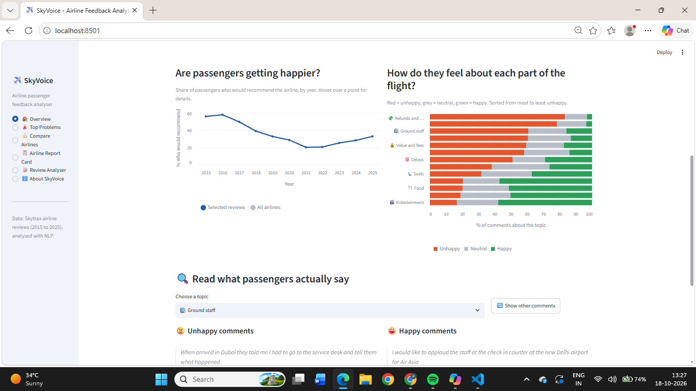
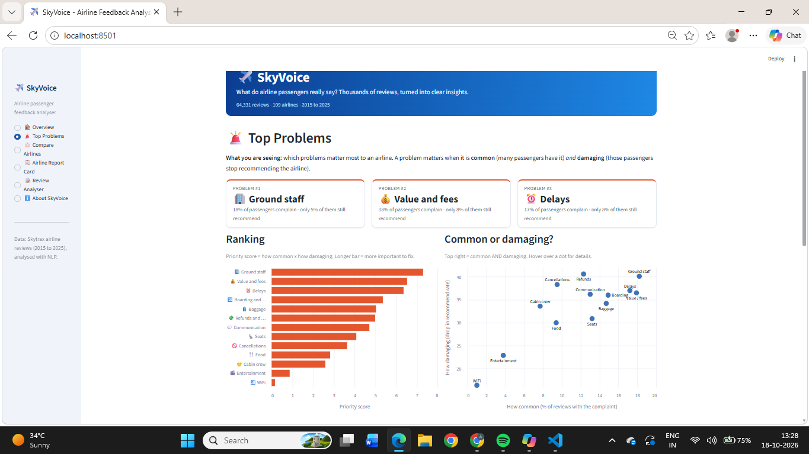
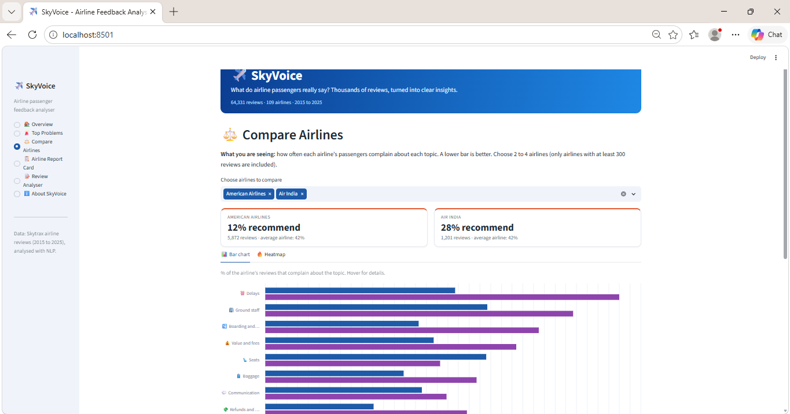
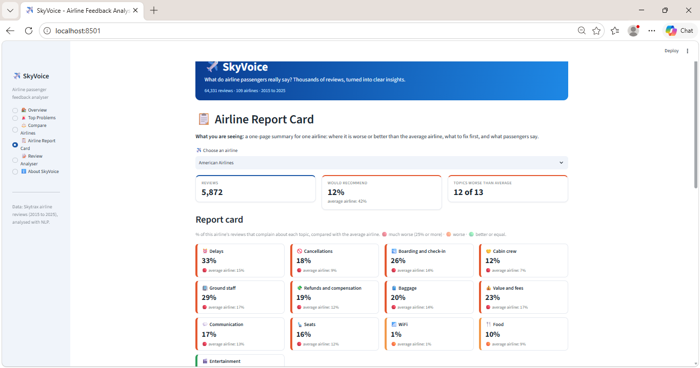
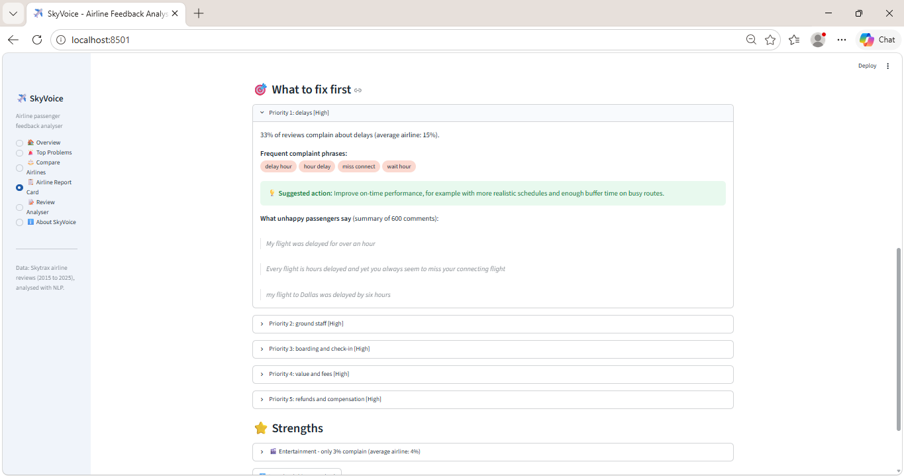
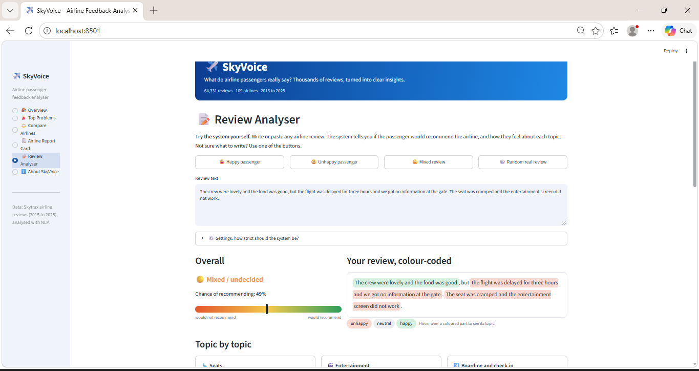
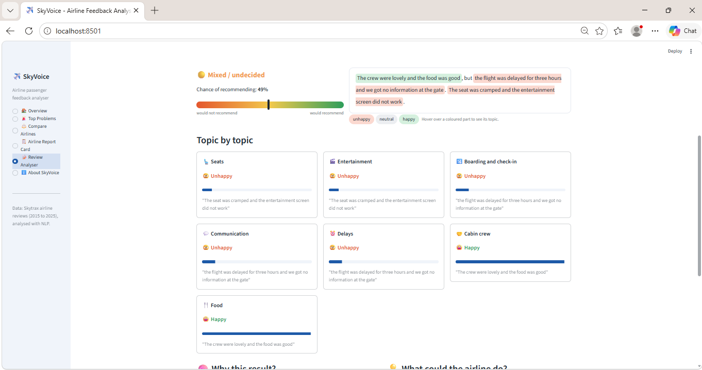
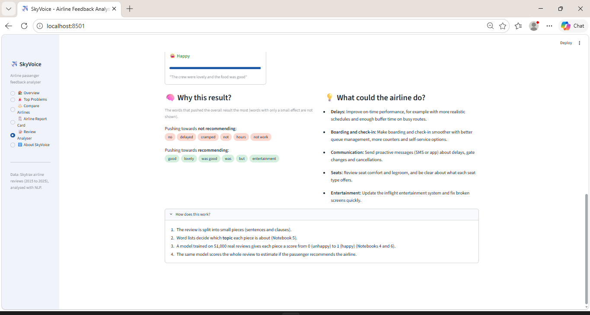

# SkyVoice: Airline Reviews Analysis Using NLP & Sentiment Analysis

An end-to-end NLP project that transforms airline passenger reviews into actionable insights using sentiment classification, aspect-based sentiment analysis, topic mining, and explainable recommendations.

## Overview

SkyVoice analyses the [Skytrax Airline Review Dataset](https://data.mendeley.com/datasets/vgjk58vf8h/1) to identify passenger pain points, compare airline performance, and prioritise service improvements through an interactive Streamlit dashboard.

## Key Results

| Metric | Result |
|---|---:|
| Original reviews | 64,740 |
| Cleaned reviews | 64,331 |
| Airlines analysed | 109 |
| Best classification accuracy | 93.5% |
| Logistic Regression F1 score | 0.916 |
| Passenger-experience topics | 13 |
| Topic-level review scores | 231,583 |
| Recommendations generated | 245 |

*Classification metrics are based on the project's held-out test set.*

## Features

- **Sentiment Classification:** Compares VADER, Multinomial Naive Bayes, and Logistic Regression using TF-IDF.
- **Aspect-Based Sentiment Analysis:** Identifies sentiment across 13 topics, including delays, cancellations, baggage, cabin crew, food, and refunds.
- **Topic Mining:** Uses POS tagging, linguistic patterns, and WordNet.
- **Business Analytics:** Analyses complaint frequency, recommendation rates, and differences between airlines.
- **Explainable Recommendations:** Generates airline-specific priorities and suggested actions using rule-based logic.
- **Text Summarisation:** Uses LexRank to extract representative passenger comments.
- **Interactive Dashboard:** Includes airline comparisons, complaint rankings, airline report cards, and a review analyser.

## Tech Stack

`Python` · `Pandas` · `NumPy` · `Scikit-learn` · `NLTK` · `VADER` · `TF-IDF` · `Logistic Regression` · `Matplotlib` · `Seaborn` · `Altair` · `Streamlit` · `Joblib`

## Methodology

The project follows a ten-stage pipeline:

1. Data cleaning and exploratory analysis
2. Text preprocessing and tokenisation
3. Sentiment classification and model comparison
4. POS tagging and topic identification
5. Aspect-level sentiment analysis
6. Validation against passenger component ratings
7. Complaint analysis and airline comparisons
8. Business insights and priority ranking
9. Rule-based recommendations
10. LexRank text summarisation

## Dashboard Preview

### 1. Overview


Filters for airline, travel class, and year, with key metrics and a plain-language summary of 64,331 cleaned reviews.



Yearly recommendation trends, sentiment across 13 passenger-experience topics, and representative passenger comments.

### 2. Complaint Analysis and Airline Comparison



Ranks high-priority issues using complaint frequency and their association with lower recommendation rates.



Compares American Airlines and Air India using recommendation rates and topic-level complaint rates.

### 3. Airline Report and Recommendations



Compares American Airlines' complaint rates against the average airline and highlights priority levels.



Highlights the leading improvement priority, frequent complaint phrases, suggested actions, and LexRank summaries.

### 4. Interactive Review Analysis



Analyses a mixed review, estimates recommendation probability, and highlights positive and negative parts of the text.



Shows separate sentiment results for topics such as cabin crew, food, seats, communication, and delays.



Explains words influencing the recommendation prediction and presents suggested actions for unhappy topics.

### 5. Methodology and Reliability


Summarises the workflow, analytical methods, reliability considerations, and project limitations.


## Installation

**1. Clone the repository**

```bash
git clone https://github.com/akshara-pant/Airline-Reviews-Analysis-using-NLP-Sentiment-Analysis.git
cd Airline-Reviews-Analysis-using-NLP-Sentiment-Analysis
```

**2. Create and activate a virtual environment**

Windows PowerShell:

```powershell
python -m venv venv
.\venv\Scripts\Activate.ps1
```

**3. Install dependencies**

```bash
pip install -r requirements.txt
```

**4. Prepare the data and model**

Obtain the dataset from [Mendeley Data](https://data.mendeley.com/datasets/vgjk58vf8h/1). If the required generated files are not included, run notebooks `01`–`10` in order.

**5. Launch the dashboard**

```bash
streamlit run app.py
```

The application requires the relevant generated data files and saved model.

## Key Findings

- Delays, cancellations, refunds, and ground staff were important areas of passenger dissatisfaction.
- Poor communication during disruptions was associated with lower airline recommendation rates.
- Passenger feedback varied substantially across airlines and service aspects.
- Complaint frequency and association with lower recommendation rates helped prioritise potential improvements.

These findings are observational and do not establish causation.

## Limitations

- Topic identification relies on keyword-based rules and linguistic patterns.
- Aspect-level performance varies by topic.
- Recommendations are rule-based and have not been experimentally validated.
- Results reflect the available review dataset and may not represent every passenger.

## Future Scope

- Transformer-based sentiment and aspect detection
- Improved topic identification using embeddings
- Integration with operational airline data
- Online deployment and automated complaint alerts
- Multilingual review analysis


